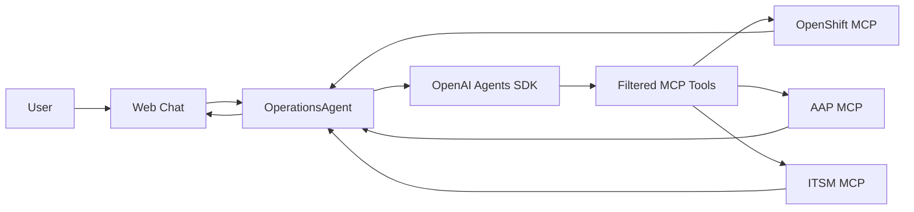
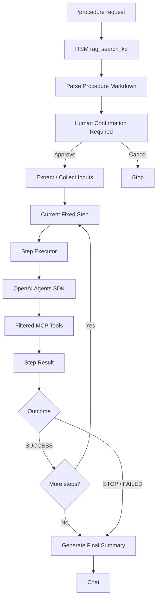
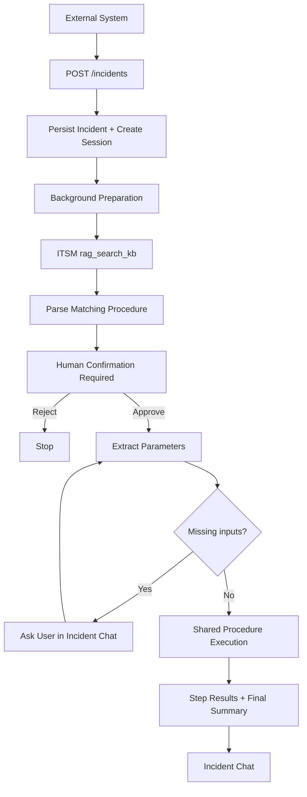

# Operations Agent

An IT Operations Agent with a web chat interface for working with operational systems through MCP.

## What this repo does

Connects to OpenShift, Ansible Automation Platform (AAP), and ITSM MCP servers. It supports conversational tool use, deterministic KB-driven procedures, and external incidents that prepare procedures for human approval.

Conversations appear on the left and incidents on the right, each with an independent persisted session. Background work continues during navigation; sidebar loaders and unread dots show activity and results.

## Installation and configuration

Requires Python 3.10 or newer and access to an OpenAI-compatible model endpoint and the three MCP servers.

```bash
make install
cp .env.example .env
# Edit .env with your model and MCP settings.
make run-app
```

Open http://127.0.0.1:8000. Run tests with `make test`.

| Group | Environment variables | Purpose |
| --- | --- | --- |
| Model | `MODEL_NAME`, `MODEL_BASE_URL`, `MODEL_API_KEY` | Required model name, API base URL, and API key. |
| OpenShift | `OPENSHIFT_MCP_URL`, `OPENSHIFT_MCP_TOKEN`, `OPENSHIFT_MCP_TLS_VERIFY` | MCP HTTP(S) endpoint, optional bearer token, TLS verification (`true`/`false`). |
| AAP | `AAP_MCP_URL`, `AAP_MCP_TOKEN`, `AAP_MCP_TLS_VERIFY` | MCP HTTP(S) endpoint, optional bearer token, TLS verification. |
| ITSM | `ITSM_MCP_URL`, `ITSM_MCP_TOKEN`, `ITSM_MCP_TLS_VERIFY` | MCP HTTP(S) endpoint, optional bearer token, TLS verification. |
| Tool filtering | `OPENSHIFT_MCP_ALLOWED_TOOLS`, `AAP_MCP_ALLOWED_TOOLS`, `ITSM_MCP_ALLOWED_TOOLS` | Comma-separated, exact namespaced tool names exposed to the model. |
| Storage | `SESSION_DB_PATH`, `INCIDENT_DB_PATH` | SQLite files; defaults: `data/sessions.sqlite3` and `data/incidents.sqlite3`. |

MCP servers may advertise many tools; the application exposes only the configured allowlists to the model. `.env.example` contains the demo defaults. An empty allowlist exposes no tools for that server. Set TLS verification appropriately for your endpoints; the example sets it to `false`.

Messages, sessions, and incidents persist in SQLite. Background tasks and active procedure runtime state do not survive a server restart.

| Area | Technology / pattern |
| --- | --- |
| Web/API | FastAPI |
| Agent runtime | OpenAI Agents SDK |
| Tool integration | Model Context Protocol (MCP) |
| Persistence | SQLite |
| Execution model | Single-agent chat + deterministic procedures + incident-triggered background workflows |

## 1. MCP mode

In normal conversations, messages without `/procedure` go to OperationsAgent, unless they answer an active procedure's input request. Through the OpenAI Agents SDK, the model selects among the configured, filtered MCP tools. Live/current system-state questions require successful MCP evidence; clearly general or conceptual explanations can be answered without MCP tools.

### Technical design

OperationsAgent uses the **OpenAI Agents SDK** in a single-agent, tool-using architecture. It is the conversational entry point for normal messages, with no planner/worker hierarchy or multi-agent orchestration. MCP defines the operational tool boundary, not a separate agent boundary.

MCP tool discovery is dynamic; application code filters discovered tools using environment-configured allowlists before exposing them to the model. The model chooses tools through normal agentic tool calling, the SDK invokes them on MCP servers, and an application-side live-evidence guardrail accepts current operational facts only with successful MCP evidence.



## 2. Procedure mode

Use `/procedure <request>` to retrieve a procedure from the ITSM knowledge base through the fixed `rag_search_kb` tool. Human-readable Markdown is parsed deterministically, then a concise proposal offers **Run procedure** and **Cancel**. Explicit approval is mandatory before parameter extraction or missing-input questions, regardless of KB confirmation metadata.

**The KB defines the steps and their order. The LLM decides how to execute only the current step using MCP tools.** After approval and input collection, steps run sequentially through the Agents SDK with filtered tools and previous successful step results as context. STOP or FAILED prevents later steps. The UI shows transient progress; permanent step results and the final natural-language summary remain in chat.

### Technical design

The pattern is **deterministic workflow orchestration plus bounded agentic execution per step**. Human-readable definitions live in the ITSM KB; `rag_search_kb` retrieves them, and Python application code parses the Markdown and owns procedure state, input collection, step order, and transitions. SUCCESS advances the workflow; STOP or FAILED ends execution.

Procedure definitions remain tool-agnostic: KB articles describe operational intent, while the Step Executor maps only the current step to available MCP tools at runtime.

The Step Executor uses the OpenAI Agents SDK with the current step, collected inputs, and previous step summaries as context. It chooses MCP tools agentically to accomplish that step, but cannot invent, reorder, or skip workflow steps. The application stores results and passes them forward. Final summarization uses stored step results through a tool-free SDK call, without re-executing operational tools.



## 3. Incident mode

External systems submit incidents to `POST /incidents`. Required fields are `title`, `message`, and `severity`; supported severities are `critical`, `warning`, and `info` (case insensitive).

```bash
curl -X POST http://127.0.0.1:8000/incidents \
  -H 'Content-Type: application/json' \
  -d '{
    "title": "High CPU on web-server-prod",
    "message": "CPU utilization above 95% for 10 minutes on node worker-03.",
    "severity": "critical"
  }'
```

Intake persists the incident and its own chat session, then starts background preparation without waiting for anyone to open the inbox item. The title and message feed the shared KB search and parser; parameter extraction starts only after approval. Useful results persist in incident chat; missing inputs are requested there. No matching procedure leaves the incident available for manual review.

**Every procedure, including incident-triggered runs, requires explicit human approval immediately after parsing, before parameter collection or the first operational step, regardless of KB confirmation metadata.** Run procedure starts extraction from the stored request, followed by missing-input collection and the shared executor; Cancel ends the flow. Typed `yes`, `run it`, and `proceed` remain supported. Successful completion marks the incident DONE. While an incident waits for procedure input or confirmation, replies are routed to that incident's procedure context rather than OperationsAgent. Without an active procedure context, follow-up messages are saved without automatic processing.

### Technical design

The pattern is **an event-driven trigger with session-scoped background processing and human-in-the-loop approval**. The FastAPI HTTP endpoint creates an incident-owned, SQLite-backed chat context. Application-managed `asyncio` tasks own its work independently of the visible conversation; processing and unread state appear in the right-side inbox while users navigate elsewhere.

An incident is another source for the shared procedure engine, not another autonomous agent. Its title and message enter the same retrieval, parsing, and parameter-extraction components used by `/procedure`. Application orchestration pauses for mandatory human confirmation first, then missing inputs; approval resumes the exact same execution pipeline and Agents SDK Step Executor.


